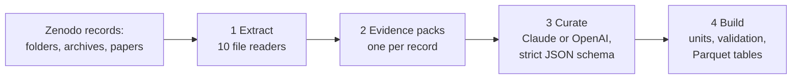

# Spectroscopy Metadata Pipeline

Turns raw spectroscopy datasets from Zenodo, together with their research
papers, into a clean, evidence-backed catalogue. For every record it states
which spectra the record holds, in which range and unit, how many, measured
how and for what purpose, and where each of those facts came from.

It is the data layer for a **foundation model for spectroscopy**: before a
model can learn across techniques, its training data has to be findable,
comparable and traceable. This repository builds that catalogue; it does not
train a model.

## Why it is needed

Open repositories hold thousands of spectroscopy datasets, but few can be
reused as they are:

- they come in dozens of formats (CSV, TXT, Excel, JCAMP-DX, HDF5, MATLAB,
  NetCDF, FITS, ENVI, vendor binaries), often inside nested or damaged
  archives;
- units differ (nm, µm, cm⁻¹, Å, eV), and what a column means is often
  written only in a README or the paper;
- many records tagged as spectroscopy contain no spectra at all.

Repository search sees only titles and keywords. This pipeline opens the files
and reads the papers, so the catalogue can answer questions such as *"NIR
datasets covering 1,000–1,700 nm with at least 500 spectra"*.

## Results (November 2026)

| | |
|---|---|
| Candidate Zenodo records (spectroscopy keyword matches) | 14,589 |
| Records reviewed, in 11 batches | 720 |
| Curated rows that hold spectra | 563 |
| Records found to hold no spectra, each with a reason | 157 (22%) |
| Spectra counted | ≈ 331 million |
| Spectral values (spectra × channels) | ≈ 136 billion |
| Files indexed by the automated stage, batches 3–10 | ≈ 774,000 (≈ 415,000 inside archives, ≈ 459 GB) |
| Automated tests | 47, all passing |

FTIR is the most common technique: 47% of the rows with spectra in batches
0–7 and 61% in batches 8–10. The analysis decks in `papers/` break the
catalogue down by spectral region, format, target and batch.

## How it works



1. **Extract** (`pipeline.py`) maps each record to its folder or archive,
   indexes every file, including members of nested and damaged archives, and
   runs the matching reader: CSV, XLSX, HDF5, NetCDF, MAT, JCAMP-DX, FITS,
   ExoMol, ENVI or plain text. Every value is stored with its evidence:
   source file, literal evidence text, method and confidence.
2. **Evidence packs** (`llm_curation/evidence_pack.py`) write one Markdown file
   per record with the repository metadata, file inventory, reader results,
   file previews, file shapes and the method sections of the paper, within a
   fixed size budget. No API calls are made here.
3. **Curate** (`llm_curation/`): Claude or OpenAI reads the pack and must answer
   in a strict JSON schema. Answers are cached per record together with the
   model, token counts and timing. Every batch, 0 to 10, also has a reviewed
   curation module in `curation/`.
4. **Build** (`curation/build.py`) converts each range to nm and cm⁻¹,
   validates the rows and writes typed Parquet tables plus CSV previews.

Outputs per batch:

- `<batch>_spectroscopy_metadata.parquet`: one row per record with spectra,
  26 columns (modality, original and converted range, channels, counts,
  resolution, sampling, imaging fields, target, source files, confidence)
- `<batch>_dataset_details.parquet`: 22 descriptive columns (format,
  preprocessing, instrument, pathlength, chemometric model, references, peaks)
- `<batch>_no_spectra.csv`: records without spectra and the reason

## Engineering highlights

- **Code for facts, the LLM for judgement.** Readers count, convert and
  measure; the model describes and decides; code then validates its answer.
  Unknown values stay empty instead of being guessed.
- **Provenance for every value**, including paths inside archives such as
  `data.zip::run1/spectrum.txt`, with evidence text, method, confidence and
  origin.
- **Archive engine**: nested zip, tar and rar archives are read without
  extracting everything, damaged zips are recovered from their local file
  headers, and large archives are read in one pass instead of once per member.
- **Deduplication that tells copies from different spectra**: same-named files
  are merged only when they are another format of the same data,
  byte-identical (BLAKE2 fingerprint) or a copy by location, such as a zip next
  to its extracted folder. The earlier rule merged on file name alone and
  hid real spectra; see the commit that fixed it.
- **Provider-independent LLM layer**: one schema serves Claude structured
  outputs and OpenAI strict mode, with retries, prompt caching and resumable
  runs.
- **Reliable batch runs**: per-record fragments, atomic writes, resumable run
  state and error tables.
- **Tested**: 47 pytest tests on synthetic data, including the whole chain run
  with a fake LLM provider, so no API key is needed.

## Tech stack

Python · pandas · NumPy · PyArrow (Parquet) · h5py · SciPy · netCDF4 ·
openpyxl · PyMuPDF · lxml · Anthropic and OpenAI SDKs · pytest

## Quick start

```bash
pip install -r requirements.txt
```

```bash
python -m pytest tests -q
```

Rebuild the curated tables of any batch from this repository alone, without
the datasets:

```bash
python build_curated_parquet.py --batch batch8 --output-dir output
```

Running a new batch needs the downloaded datasets, their papers and the
Zenodo metadata CSV. None of these, nor the generated `output/` folder, are
part of this repository.

## Repository layout

```
run_batch.py              end-to-end run: extract -> packs -> curate -> build
pipeline.py               extraction engine, deduplication, run state
build_curated_parquet.py  final tables of one curated batch
scanner/                  record-to-folder mapping, file index, archive access
readers/                  the 10 format readers and shared helpers
llm_curation/             evidence packs, prompts, schema, providers, runner
curation/                 curated batches 0-10 and the table builder
pdf/, extraction/         paper text (PDF, JATS XML) and regex evidence
evidence/, normalization/ provenance records, unit conversion
storage/, validation/     Parquet schemas and writer, range checks
config/                   one YAML file per batch
tests/                    pytest suite
papers/                   analysis decks for batches 0-7 and 8-10
```

## Running a batch

### Input layout

```
<Datasets>/<record_id>_<title>/...   one folder (or archive) per Zenodo record
<papers>/<record_id>.pdf | .xml      the paper (PDF or PMC JATS XML)
```

The Zenodo metadata CSV (default `D:/zenodo_metadata.csv`, change it with
`--metadata`) adds the title, DOI, description and creators. Records that are
missing from it get a title taken from the folder name.

### API key

Put the key in the environment or in a `.env` file in this folder. The `.env`
file is ignored by Git.

```
ANTHROPIC_API_KEY=...
# or
OPENAI_API_KEY=...
```

### Commands

```bash
python run_batch.py --batch batch9 --datasets E:/Batch9/Datasets --papers E:/Batch9/papers --provider anthropic
```

```bash
python run_batch.py --batch batch9 --datasets E:/Batch9/Datasets --papers E:/Batch9/papers --provider openai --model gpt-5.5
```

The first run writes `config/config_batch9.yaml`. Later runs can use
`--config config/config_batch9.yaml`.

The run has four steps; `--steps` picks a subset:

| step | what it does | output |
|---|---|---|
| `extract` | automated readers (CSV/TXT/XLS(X)/JCAMP/HDF5/MAT/NetCDF/OPUS-dpt/... including archive members) | `output/<batch>/{dataset_file_index,spectroscopy_metadata,evidence,extraction_errors,extraction_state}.parquet` |
| `packs` | evidence pack per record: metadata, file inventory, file previews, automated results, paper methods | `output/<batch>/llm_packs/<id>.md` |
| `curate` | Claude or OpenAI reads each pack and returns schema-checked JSON | `output/<batch>/llm_curation/<id>.json` |
| `build` | curated parquet tables + no-spectra list | `output/<batch>_*.parquet` |

Useful options:

* `--record-id 4984607` (repeatable) runs only those records.
* `--force` redoes records that already have results. Without it, curation can be resumed after an interruption.
* `--source llm|module` forces the build to read LLM JSON or the curated `curation/<batch>_*.py` modules. The default `auto` uses a module when one exists.

LLM settings live in the `llm:` block of the config: provider, model (default
`claude-opus-5-5` / `gpt-5.5`), effort, token limits, pack sizes and
concurrency. Failed records are listed in `llm_curation/_failures.json`. Re-run
with the same command to retry them.

### Rebuilding curated batches

Every batch from 0 to 10 has a curation module pair:
`curation/<batch>_spectral.py` (dicts `R` and `NO_SPECTRA`) and
`curation/<batch>_details.py` (dict `R2`). Rebuild a batch's tables with
either command; the first one also re-reads the dataset folders named in the
batch config:

```bash
python run_batch.py --config config/config_batch8.yaml --batch batch8 --steps build
```

```bash
python build_curated_parquet.py --batch batch8 --output-dir output
```

## Curation conventions (also given to the LLM)

* `num_spectra` counts individual spectra. `num_spectral_values` is spectra × channels. Approximate counts are marked "approx." in a code comment or remark.
* nm and cm-1 ranges are derived from the original range for the units nm, um, Angstrom, cm-1, eV and meV.
* Records with only non-optical data (XRD, NMR, MS, EIS, images, summary tables) go to `NO_SPECTRA`.
* Data that exists only in Origin `.opj/.opju` projects is recorded with modality and context but null ranges and low confidence. These files cannot be parsed here.

## Known limitations

* Origin `.opj/.opju`, PerkinElmer `.sp`, Bruker OPUS binaries and other vendor binaries are previewed as strings only. The LLM gets their names and context, not their values.
* Wide tables whose header line starts with `#` can be transposed by the automated text reader (seen in Batch8 record 1134664). The curated numbers come from the files, not from the automated row.
* The XLSX reader misses spectra laid out as several x/y column blocks per sheet. Evidence packs include sheet previews and numeric summaries so the LLM can count them.
* The LLM stage has not yet been measured against the curated batches as a gold set.
* 720 of the 14,589 candidate records have been processed so far.

## Tests

```bash
python -m pytest tests -q
```

`tests/test_llm_curation.py` runs the whole chain (extract → packs → curate →
build) on a small synthetic dataset with a fake provider, so it needs no API
key. `tests/test_deduplicate.py` covers the deduplication rules, two of them
through the real pipeline.

## Author

Arbindra Patel
